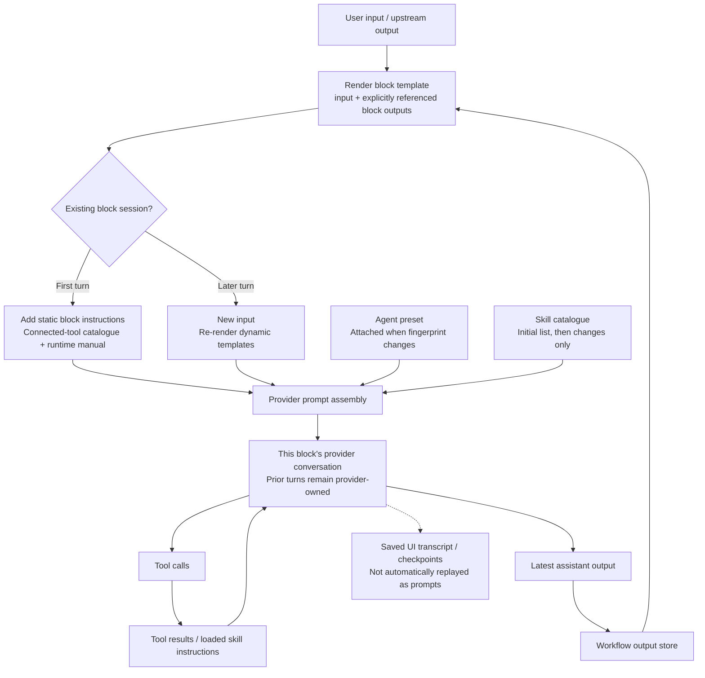
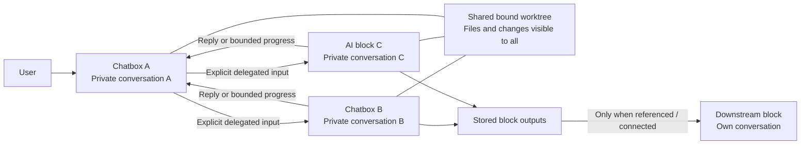

# Workflow context, caching, and snowballing

Investigation date: 15 October 2026.

The architecture avoids blindly copying every chat into every other chat. The main snowballing risk is repeatedly feeding large outputs into persistent conversations. There are also gaps in budget accounting and recovery.

This investigation traced the workflow runner, provider sessions, skills, templates, and chat continuation paths. All 61 targeted tests passed. This describes repository behavior; actual provider cache hits require runtime measurements.

## How context gets attached



On later turns, static workflow instructions and the runtime manual are normally omitted. Dynamic templates are expanded again, including `{{blocks.ID.output}}`.

Source: [Prompt construction](packages/core/src/harness-runner.ts), `executeFlow` and `executeBlock`.

## Multi-chatbox and complex flows



Each block gets a separate session alias based on run ID + block ID, pointing to the same bound worktree. This isolates conversation identity while sharing files.

Source: [Session identity](packages/core/src/server.ts), `workflowSessionWorkspace`.

| Situation | What is reused or transferred |
| --- | --- |
| Another message to the same chatbox | Its existing provider conversation |
| A calls B | Explicit input goes to B; B's private transcript is not copied |
| A calls B again | B continues its existing conversation |
| B finishes | Its returned output enters A's tool-result history |
| A starts B in background | Immediate `started` result; progress must be requested |
| Multiple blocks join in a traditional graph | Available predecessor outputs are concatenated |
| Loop or review correction | Existing owner conversation generally continues; review dispatch uses a fresh session |
| Rerun | New run/session identities; bound workspace and files can remain |
| Provider restart | Attempts native session loading; otherwise starts a fresh provider session |

## What “cache” means here

| Mechanism | What it actually saves | Limitation |
| --- | --- | --- |
| Live provider session | Existing conversation and running ACP connection | History can keep growing |
| Native session loading | Provider conversation across process restarts | Depends on provider support and successful loading |
| Instruction deduplication | Avoids resending unchanged agent instructions, skill catalogue, and workflow manual | Previously attached text still exists in conversation history |
| Progress-read fingerprint | Repeated identical `workflow_block_messages` calls return `unchanged` | `tail`, timeout snapshots, and `include_unchanged` do not use the same suppression |
| Stored block outputs | Keeps results available for templates and downstream blocks | Referencing them inserts their text again |
| UI transcript/archive cache | Speeds display and preserves conversation records | Does not restore model memory by itself |
| Provider token cache | Core displays reported cache-read/write counts | Core does not control or guarantee cache hits |

Reusing a conversation is not the same as a token-cache hit. Cached input also does not mean that input stops occupying context. The implementation records provider-reported usage; it does not implement its own model cache.

Source: [Provider implementation](packages/core/src/ai/stdio-provider.ts), `runPrompt`, `withSkillCatalogue`, `withSessionAgent`, `ensureRuntime`, and `connect`.

## Where context can snowball

| Priority | Point | Why it grows |
| --- | --- | --- |
| High | Dynamic output templates | The same large output can be inserted on every chat turn, even though an earlier copy remains in history |
| High | Coordinator ↔ worker loops | Coordinator sends growing context; worker returns a growing report; coordinator forwards that report again |
| High | Large tool results and logs | Results enter the caller's conversation. Avoiding duplicate JSON fields helps, but does not make a large result small |
| High | Fan-in joins | Several predecessor outputs become one concatenated input, without summarization |
| Medium | Polling | Changed snapshots can repeat overlapping messages. Direct `tail` calls also repeat unchanged content |
| Medium | Repeated skill loads | Instructions load on demand, but repeated loads can attach the same full instructions again |
| Medium | Long-lived chatboxes | Every continuation adds history; Core relies on provider-side compaction |

For example, a template containing a 20,000-character report used over 10 turns can attach roughly 200,000 characters of that report, before counting replies and tool results. This is an illustrative calculation, not a measured run.

Existing protections include descriptions previewed to 512 characters, polling messages capped at 8,000 characters each, unchanged polling suppressed, and app results avoiding two copies of the same logs.

Sources: [Workflow runner](packages/core/src/harness-runner.ts), `flowBlockMessages`, `callFlowTool`, `connectedInput`, and `workflowBlockDescription`; [Template rendering](packages/core/src/harness-graph.ts), `renderHarnessPrompt`.

## Important gaps

### 1. Workflow token budget is not a reliable cumulative spend limit

Provider usage overwrites `session.tokens` with the latest reported turn; the runner then sums the current token values across blocks. Earlier turns can disappear from that total. Checks also happen after work, so they cannot prevent a large turn from running.

Sources: [Budget check](packages/core/src/harness-runner.ts), `assertTokenBudget`; [Usage assignment](packages/core/src/ai/stdio-provider.ts), `runPrompt`.

### 2. Character limits do not bound conversation size

The default rendered-prompt limit is 100,000 characters; the default block-output limit is 200,000. These are per-item limits, not total-context limits. Some flow paths retain full results in memory/tool returns while truncating only the persisted display output.

Source: [Workflow runner](packages/core/src/harness-runner.ts), `executeBlock`, `executeFlow`, and `output`.

### 3. Failed session restoration can lose necessary instructions

The runner may omit static instructions because a block has a recorded session, while the provider falls back to a new conversation. The provider resets its agent/catalogue markers, but the workflow manual is not automatically rebuilt at that layer.

Sources: [Workflow continuation](packages/core/src/harness-runner.ts), `executeFlow`; [Resume fallback](packages/core/src/ai/stdio-provider.ts), `ensureRuntime` and `connect`.

### 4. Transcript trimming is not model compaction

Keeping the last 1,000 UI messages or 200 chatbox messages limits stored/displayed history; it does not trim the provider's actual conversation.

## Recommended changes

1. Fix cumulative accounting across turns and distinguish spend, latest-turn usage, and current context occupancy.
2. Add per-call result budgets, including tool results and fan-in inputs.
3. Send output changes or artifact references instead of repeatedly attaching full reports.
4. Make polling incremental rather than repeatedly returning overlapping snapshots.
5. Explicitly reattach required instructions after a fresh-session fallback.

For complex flows, keep each worker's handoff compact: result, evidence references, and unresolved issues. Leave detailed logs in files.

## Validation

```bash
npm test -w @remote-ide/core -- src/workflow-context-budget.test.ts src/workflow-flow.test.ts src/workflow-skills.test.ts --minWorkers=1 --maxWorkers=1
```

All 61 tests passed across three files. The initial sandboxed run blocked process inspection (`ps`) in three app lifecycle tests; rerunning with the required process permissions passed.

No implementation changes were made during this investigation.
